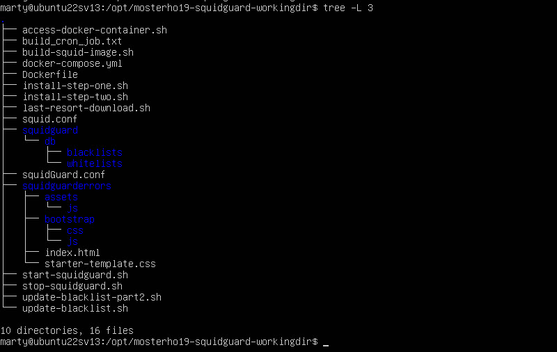
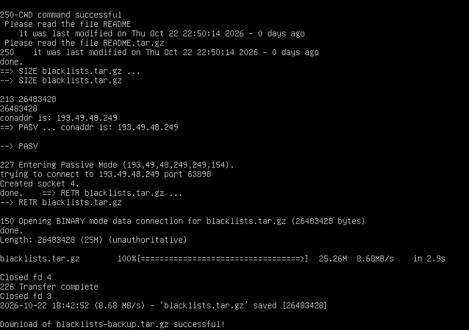
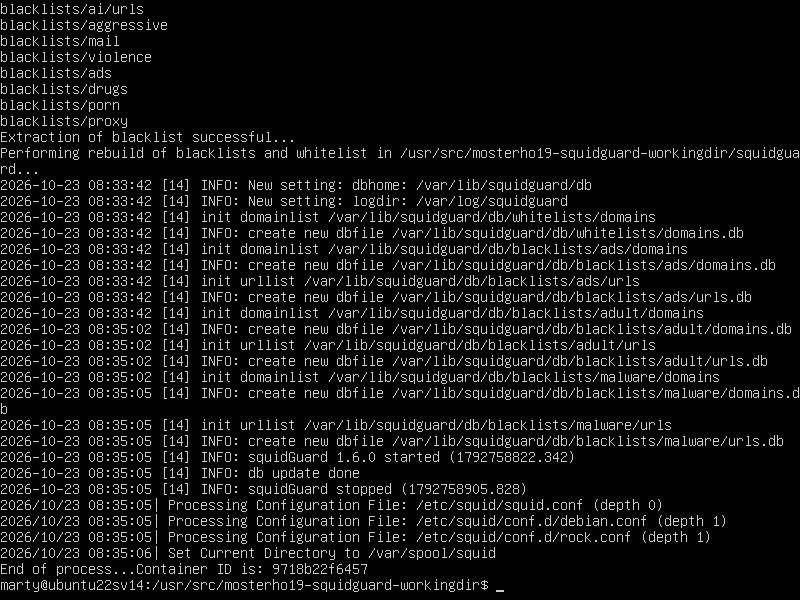
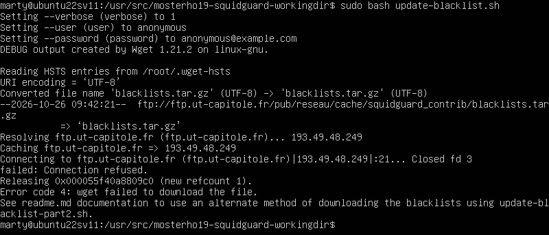
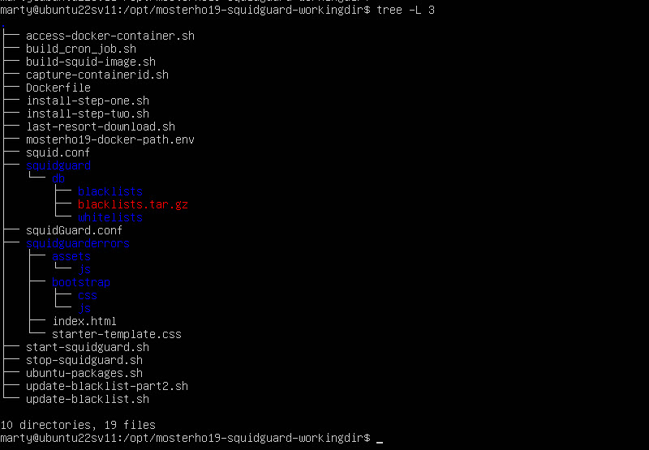
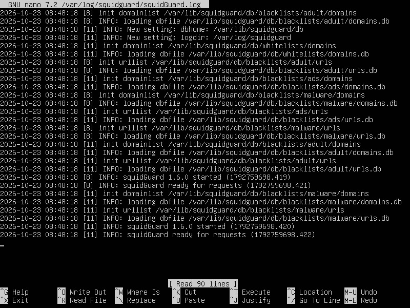
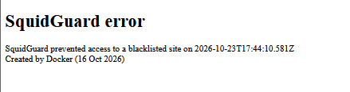

# Squid and Squidguard running in Docker on a Ubuntu server (version 22.04.5 LTS)
### I am very new to Docker, so this is very much a work in process. I have also learned a lot about bash scripting, so hopefully this will be relatively easy to install.
### If you've been following this repository, I think I'll finally have a stable version as of 26 October 2026. From now on I'll follow the convention regarding stable versus release, etc.

> "The first 90 percent of the code accounts for the first 90 percent of the development time. The remaining 10 percent of the code accounts for the other 90 percent of the development time."

### Note that my Docker profile is "mosterho19" and github is "mosterho". My Docker repository can be [found here (Docker)](https://hub.docker.com/repository/docker/mosterho19/squidguard/general). Source code in github can be [found here (github)](https://github.com/mosterho/mosterho19-squidguard/tree/main).

## Notes
<ol>
<li>Please don't perform a Docker pull directly from a terminal session or the Docker website, it won't work as a standalone. Follow this document and use the bash files from the github repository to help build the application for you. 
<li>UPDATE: just realized /usr/src is not the best place to put scripts. I changed all references from /usr/src to /opt.
<li>UPDATE: I removed all references to using a home folder to run the server scripts, but I do reference it when doing certain downloads.
<li>git is installed on the server, but I'm not familiar enough with git's command lines to pull the repository onto the server. </li>
<li>If you don't see any pictures in the Docker repository, try the README in the Github repository link.
</ol>

[github repository here](https://github.com/mosterho/mosterho19-squidguard/tree/main)

## Quick Start Install Guide
<ol>
<li>Install Ubuntu server, latest updates, and Docker with additional packages.
<li>Using the github link, download and unzip mosterho19-squidguard-main.zip and copy to Ubuntu system folder /opt.
<li>Make any neccessary changes to files (e.g., squid.conf, squidguard.conf, etc.)
<li>Pull Docker images into /opt/mosterho19-squidguard-workingdir folder by running "sudo bash ./install-step-one.sh"
<li>Setup Docker folders and files in /opt/mosterho19-squidguard-workingdir folder by running "sudo bash ./install-step-two.sh"
<ul><li>See the "ISSUES" section if the wget download from the blacklist download site doesn't work</li></ul>
<li>Confirm squid, squidguard, and httpd are running in the Docker session.
</ol>

## Install Ubuntu server.
<ol>
<li>Install Ubuntu server 22.04.5 LTS. Mine is on VMware Workstation, 8Gb of memory with 1 processor/4 core and 50Gb of disk. 
	<ul>
	<li>Accept defaults during install, except check the box to install ssh-server (you will need this later).</li>
	</ul>
</li>
<li>sudo apt update</li>
<li>sudo apt full-upgrade</li>
<li>sudo apt install docker docker.io docker-buildx unzip net-tools tree</li>
<li>If you're using VMware, consider installing vmware-manager.
	<ul>
	<li>sudo apt install vmware-manager</li>
	</ul>
<li>sudo dpkg-reconfigure tzdata (select the time zone applicable for you)</li>
<li>timedatectl (confirms the tzdata change)</li>
<li>ifconfig
	<ul>
	<li>make a note of the assigned IPv4 address of the network adapter</li>
</li>
</ol>

## Download Folders and Files from github
<ol>
<li>In order to download the application, log on to a PC, go to the github repository, click the green Code button, and select Download ZIP. Copy the file to the new server's folder of your choice (if on a Windows PC you can use Filezilla client or the scp command).</li>
<li>Example scp transfer from a Windows PC command prompt to the new Ubuntu server (replace three instances of "user" below with whatever usernames you have).

> scp C:\Users\\(user)\Downloads\mosterho19-squidguard-main.zip (user)@192.168.##.##:/home/(user)

[github](https://github.com/mosterho/mosterho19-squidguard/tree/main)

<li>mosterho19-squidguard-main.zip -- this contains the entire repository, including this READEME and .jpg files. The basic folder structures and bash files for running squidguard are within folder "mosterho19-squidguard-workingdir". This does not include the squidguard db binary files that contain the blacklists.tar.gz; this will be built later.
<li>Log on to the server
<li>Run the following: "sudo unzip mosterho19-squidguard-main.zip". This will create the mosterho19-squidguard-main folder with user "root" as the owner.
<li>The top-most folder in the heirarchy should be mosterho19-squidguard-main (the name of the github project), with mosterho19-squidguard-workingdir (the folder containing the objects to run squid and squidguard) beneath it.
<li>Change your working directory to "mosterho19-squidguard-main" and run "tree -L 3", the results should look like this (as I tweak documentation, the number of .jpg files may change):</li>

<li>To just move or copy the necessary folders and files to /opt, you can do this now by:
<ul>
<li>sudo cp -r mosterho19-squidguard-main/mosterho19-squidguard-workingdir/ /opt/
<li>cd /opt/mosterho19-squidguard-workingdir
</ul>
</ol>

## Make Changes to .conf Files
<ol>
<li>You <strong>may</strong> need to make changes to squid.conf, squidGuard.conf and start-squidguard.sh, and <strong>should</strong> change the email address in the update-blacklist.sh.
<li>Confirm the following folders and files are in "/mosterho19-squidguard-workingdir". 
	<ul>
	<li>directory "squidguard" -- The blacklist and whitelist files will be setup in this directory. 
	<li>directory "squidguarderrors" -- This is used by the httpd image. This contains a couple folders and an index.html file. The html file is used for issuing a warning message when attempting to display a blacklisted site. 
	<li>file "squid.conf" -- there are over 9000 lines in the original squid.conf file; this file contains about 100 lines. All of the uncommented lines with some of the important comments were included. This contains the minimum required to get squidguard up and running. You may need to tweak this file to get your container up and running (e.g., even though it is commented out, I assume you don't need the dns_nameservers tag at the very end; I just happen to use an Intranet). 
	<li>file "squidGuard.conf" -- Currently setup to include all localnet IP addresses, a blacklist, and whitelist. The blacklists currently include ads, adult, and malware. You may need to change the IP address of the redirect statement to match the IP of the Ubuntu server; however using Docker's IP 172.17.0.1 works for me. 
	<li>file "start-squidguard.sh" -- The script uses the system's time zone, but you can change the timezone environment flag (-e) for your needs.
	<li>file "update-blacklist.sh" -- consider changing the email address used as the password in the "wget" command. This FTP site allows the user to be "anonymous", so please follow netiquette and use a legitimate email address as the password.
	<li>The .sh files can be modified to accomodate any changes you need. 
	</ul>
</li>
</ol>

## Pull Docker images
<ol>
<li>Ensure you are in mosterho19-squidguard-workingdir -- you should have sufficient rights to save and run bash files using sudo.
<li>run "sudo bash install-step-one.sh"
<li>This will pull Docker images mosterho19/squidguard and httpd and create the corresponding containers. It will also create a file "mosterho19-docker-path.env".
<li>The script will show the results of creating the containers (sudo docker ps -a). It will also show that the containers' status is created, not running.
<li>The whitelist and blacklists binary DB files have not been created yet.
</ol>

## Setup Docker folders and files
<ol>
<li>Run "sudo bash install-step-two.sh"
<li>There will be a series of commands that will display results very fast. 
<li>If the blacklists.tar.gz download is successful, the script will start building the blacklist binary DB files. 
<ul>
<li>It may appear that the system froze when creating a large blacklist, but it is running OK.
</ul><li>If the blacklists.tar.gz download was successful and the docker containers started, after a few minutes you should see something similar to the second screen capture below.</li>

---

<li>There is a possibility that the (ftp.ut-capitole.fr) blacklists.tar.gz download may fail; if it does, the script should download the "last resort" tar.gz file from an MS Azure site. </li>
<li>Screen capture of a failed download (ftp.ut-capitole.fr website down):

<li>If the MS Azure last resort download also failed, go to the ISSUES section, follow those instructions, and then come back here.
<li>Once you have a successful blacklist file download and setup the folders and files **(whether automatically using the above instructions or manually),** the tree structure should look like this (again, if you don't see the picture in Docker, try Github):</li>
</ol>

## Confirm Squidguard is running
<ol>
<li>Confirm that the containers are still running by running "sudo docker ps"
<li>Run "bash ./access-docker-container.sh". Confirm you are in the running container by checking your login.
	<ul>
	<li>The login should look similar to "root@d36c...:/#"... which is the containerID.
	</li>
	</ul>
<li>Run "nano /var/log/squidguard/squidGuard.log"
<li>Confirm that the last line reads "squidguard ready for requests".
<li>If you see several "db_open: permission denied", the issue is likely back on the host. The tar extract and db file build will likely create the folders and files with root as the owner.
<li>Exit the Docker terminal session. Change your current directory to mosterho19-squidguard-workingdir. Squidguard pulls files from the Ubuntu host. The blacklist download and DB build routines should have set the owners and permissions to the minimum required. Please double-check folder permissions as 755, files as 644, and owner/group as proxy:proxy in the "squidguard/db" directory, subdirectories and files.
<li>The following screen capture shows what the log should look like.

</ol>

## Open a browser and try it ;-) 
<ol>
<li>Change your system's proxy to point to the IP address of the server that hosts this application.
<li>Open a browser. Go to a site that you believe should be blocked. Hopfully you will see the following:

</ol>

## How to Update the Blacklist or Whitelist
<ol>
<li>It's a good idea to periodically update the blacklists. 
<ul>
<li>To update the blacklist, simply set your directory to "mosterho19-squidguard-workingdir" and run "sudo bash update-blacklist.sh".
</ul>
<li>If you wish to udpate the whitelist, perform the following:
<ul>
<li>Set your directory to mosterho19-squidguard-workingdir
<li>Run "sudo nano squidguard/db/whitelists/domains". Add any websites to be whitelisted.
<li>Run "sudo bash update-blacklist-part2.sh" (running squidGuard with the "-C all" option rebuilds all lists).
</ul>
<li>You should see successful results such as in the screen captures above.
</ol>

## Additional/helpful Scripts
<ol>
<li>access-docker-container.sh -- This will start a terminal session to the currently running squidguard container. 
<ul>
<li>Saves from running "sudo docker ps", make a note of the containerID, then run "sudo docker exec -it (containerID) bash"
</ul>
<li>build_cron_job.sh -- Create a CRON job that will run the "update-blacklist.sh" script. Before running this, you will have to change the "CRON_LINE="*/5 * * * * " line to run the job at a time of your choosing.
<li>build-squid-image.sh -- Manually modify the Dockerfile for your requirements, then run this script. The image will be updated to the Docker.IO section.
<li>capture-containerid.sh -- Used by a couple programs to retrieve the squidguard containerid.
</ol>

## Issues
<ol>
<li>While doing test installations, I've made a handful of mistakes, such as forget to copy the "mosterho19-squidguard-workingdir" directory to /opt. It seems to work if you work with that directory as needed when running scripts, running "chown", etc. Or you can find all objects unzipped from the "mosterho19-squidguard-main.zip", delete them and start the install over.
<li>IMPORTANT: The scripts to download the blacklists from this [Blacklist FTP Download site](ftp://ftp.ut-capitole.fr/pub/reseau/cache/squidguard_contrib/blacklists.tar.gz) aren't totally reliable. I'm not sure if it's the nature of using wget to download tar files from ftp.ut-capitole.fr, or if the website itself has uptime issues. 
<ul>
<li>Open a browser and use the following link to download the blacklists.tar.gz file. 

([Blacklist download website here](https://dsi.ut-capitole.fr/blacklists/download/))
<li>If you receive an error message, the site may be down for maintenance.

([Homepage for Blacklist website here](https://dsi.ut-capitole.fr/))

<li>As a last resort, if you click on the following link, it will automatically download a slightly outdated blacklists.tar.gz to your Download folder.

([Blacklist Download Last Resort here](https://blacklistdownload.blob.core.windows.net/blacklist-copy-dsi-ut-capitole/blacklists.tar.gz))
<li>Once the blacklists.tar.gz file is downloaded using a web browser, copy it to "mosterho19-squidguard-workingdir/squidguard/db". Depending on rights assigned to the folders on the server, you may have to download the file to your /home/user folder first, then copy to "mosterho19-squidguard-workingdir/squidguard/db". Don't forget to replace "user" with your username.

On a Windows pc:
> scp C:\Users\user\Downloads\blacklists.tar.gz user@192.168.##.##:/opt/mosterho19-squidguard-workingdir/squidguard/db

If the folder rights on the destination server don't allow that (permission denied)
On a pc:
> scp C:\Users\user\Downloads\blacklists.tar.gz user@192.168.##.##:/home/user

then on the server:
> sudo cp /home/user/blacklists.tar.gz /opt/mosterho19-squidguard-workingdir/squidguard/db

<li>Ensure you are in directory "mosterho19-squidguard-workingdir". 
<li>Run "sudo bash update-blacklist-part2.sh"</li>
<li>Do not run "sudo bash install-step-two.sh" if the download failed; running another download will likely fail again and bypass the blacklist build process. Running "sudo bash update-blacklist-part2.sh" is a module within the install-step-two.sh script that will build the whitelist and blacklist.
<li>If you came to this point because the original "sudo bash install-step-two.sh" download failed, return to line #7 that pointed you here. 
</ul>
</ol>

# Next Steps for this Project
<ol>
<li>Create a CRON job for nightly updates to the blacklists (both on Ubuntu and within the Docker repository).
	<ul>
	<li>CRON job setup for Ubuntu only 31 Oct 2026. Must manually change the script "build_cron_job.sh" before running it.
	</ul>
<li>Autostart the containers if the Ubuntu server reboots.
<li>Learn how to create a .deb file to install on Ubuntu.
<li>Install this on Microsoft Azure as-is (Ubuntu server, Docker, etc.).
<li>Make this an all-Docker application (i.e., no Ubuntu server needed that references volumes). 
</li>