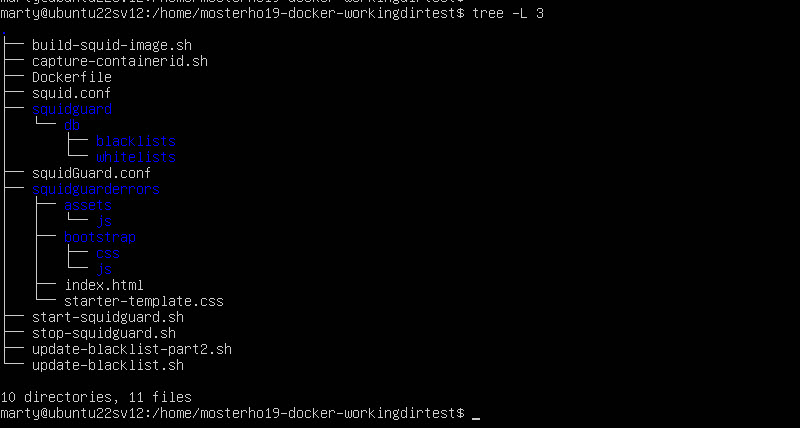

# Squid and Squidguard running in Docker on a Ubuntu server (version 22.04.5)
### I am very new to Docker, so this is very much a work in process.
### If you've been following this repository, I think I'll finally have a stable version as of 26 October 2026. From now on I'll follow the convention regarding stable versus release, etc.

> "The first 90 percent of the code accounts for the first 90 percent of the development time. The remaining 10 percent of the code accounts for the other 90 percent of the development time."

### Note that my Docker profile is "mosterho19" and github is "mosterho". My Docker repository can be [found here (Docker)](https://hub.docker.com/repository/docker/mosterho19/squidguard/general). Source code in github can be [found here (github)](https://github.com/mosterho/mosterho19-squidguard/tree/main).

## Notes
<ol>
<li>When referencing /home/(your_working_folder) in this document, the actual path can be whatever you wish. I chose "/home/mosterho19-squidguard-workingdir" for my system. During testing I have installed the objects in different folder paths (e.g., "/usr/src/mosterho19-squidguard-workingdir") and the instructions seem to work.</li>
<li>To download the github repository, log on to a Windows PC for ease of use. Go to the github repository, click the green Code button, and select Download ZIP. Copy the file to the new server's folder of your choice (I use Filezilla client to push the file to the new server and my home logon folder).</li>
<ul>
<li>git is installed on the server, but I'm not familiar enough with git command line to download the repository using a pull onto the server. 
</ul>
</ol>

[github repository here](https://hub.docker.com/repository/docker/mosterho19/squidguard/general)

## Install Ubuntu server.
<ol>
<li>Install Ubuntu server 22.04.5. Mine is on VMware Workstation, 4Gb of memory with 1 processor/4 core and 50Gb of disk. 
	<ul>
	<li>Accept defaults during install, except check the box to install ssh-server (you may need this later).</li>
	</ul>
</li>
<li>sudo apt update</li>
<li>sudo apt full-upgrade</li>
<li>sudo apt install docker docker.io docker-buildx unzip</li>
<li>Optional software to install: 
	<ul>
	<li>sudo apt install net-tools tree</li>
	</ul>
</li>
<li>If you're using VMware, consider installing vmware-manager.
	<ul>
	<li>sudo apt install vmware-manager</li>
	</ul>
<li>sudo dpkg-reconfigure tzdata (select the time zone applicable for you)</li>
<li>timedatectl (confirms the tzdata change)</li>
<li>ifconfig
	<ul>
	<li>make a note of the assigned IPv4 address of the network adapter</li>
</li>
</ol>

## Download folders and files
<ol>
<li>If you haven't done so already, download the repository from [github](https://github.com/mosterho/mosterho19-squidguard/tree/main) and place them in your /home/(your_user_name) folder, but don't extract or run anything just yet.
	<ul>
	<li>mosterho19-squidguard-main.zip -- this contains basic folder structures and bash files for running squidguard. This does not include the squidguard db files that contain the blacklists.tar.gz; this will be built later.
	</ul>
<li>Run the following: "unzip mosterho19-squidguard-main.zip". This will create the mosterho19-squidguard-main folder.
<li>The top-most folder in the heirarchy should be mosterho19-squidguard-main (the name of the github project), with mosterho19-squidguard-workingdir (the folder containing the objects to run squidguard) beneath it.
<li>If you run "tree -L 3" from your working folder, the results should look like this:</li>

<li>Copy or move folder "mosterho19-squidguard-workingdir" to your preferred directory (/user/mosterho19-squidguard-workingdir or /usr/src/mosterho19-squidguard-workingdir)
<li>Run the following: sudo chown -R proxy:proxy mosterho19-squidguard-workingdir
<li>Run the following: sudo chmod -R 777 mosterho19-squidguard-workingdir
<ul><li>This is temporary, rights will be back to 644 once the installation is complete.
</ol>

## Pull Docker images
<ol>
<li>Ensure you are in /home/(your_working_folder) (or usr/src/mosterho19-squidguard-workingdir) -- you should have sufficient rights to save and run bash files.
<li>run "sudo bash ./install-step-one.sh"
<li>This will pull Docker images mosterho19/squidguard and httpd and create the corresponding containers. It will also create a file "mosterho19-docker-path.env".
<ol>

## Setup Docker folders and files
<ol>
	<li>Run "install-step-two.sh"
	<li>There will be a series of commands that will display results very fast. You should be able to catch something like this if the blacklist download is successful</li>

<ul>
	<li>IMPORTANT: This will create an environment variable called "mosterho19squidguardpath" with your present working directory as the value (e.g., my value is "/home/mosterho19-squidguard-workingdir).
	<li>Run "sudo chown -R proxy:proxy db/
	<li>Change your present directory back to "/home/(your_working_folder)"
	</ul>
<li>Confirm the following folders and files are in your /home/(your_working_folder)
	<ul>
	<li>directory "squidguard" -- The blacklist and whitelist files will be setup in this directory. 
	<li>directory squidguarderrors. This is used by the httpd image. This contains a couple folders and an index.html file. The html file is used for issuing a warning message when attempting to display a blacklisted site. 
	<li>file squid.conf -- there are over 9000 lines in the original squid.conf file; this file contains about 100 lines. All of the uncommented lines with some of the important comments were included. This contains the minimum required to get squidguard up and running. You will need to tweak this file to get your container up and running (e.g., I assume you don't need the dns_nameservers tag at the very end; I just happen to use an Intranet). 
	<li>file squidGuard.conf -- Currently setup to include all localnet IP addresses, a blacklist, and whitelist. The blacklists currently include ads, adult, and malware. You will need to change the IP address of the redirect statement to match your IP (not sure if localhost will work in place of an IP address). 
	<li>The extra .sh files (build-squid-image, capture-container, start-squidguard, stop-squidguard, update-blacklist and update-blacklist-part2) are optional, and you can create your own version of them as needed.
	</ul>
</li>
<li>Once you setup the above folders and files, the tree structure should look like this (if you don't see the picture in Docker, try Github):</li>
</ol>

## Starting Squidguard
### The following will be used to build the squidGuard domains.db files
<ol>
<li>Run the "sudo bash ./start-squidguard.sh" on the first run</li>
<ul>
	<li>the containers must be running before the next step, even though there are no blacklists setup.</li>
</ul>
<li>Run the "update-blacklist.sh" on the first run and anytime you wish to update the blacklists.</li>
<ul>
	<li>Run the "sudo bash ./start-squidguard.sh" file. Wait for several seconds or a minute for the next step.
	<li>Confirm that the containers are still running by running "sudo docker ps -a"
	<li>Make a note of the "mosterho19/squidguard" containerid that is running.
	<li>Run "sudo docker exec -it (containerid) bash". Confirm you are in the running container by checking your login.
		<ul>
		<li>The login and folder should look like "root@d36c...:/#".
		</li>
		</ul>
		<li>Run "nano /var/log/squidguard/squidGuard.log"
		<ul>
		<li>Confirm that the last line reads "squidguard ready for requests".
		<li>If you see several "db_open: permission denied", the issue is likely back on the host. The tar extract will likely create the folders with root as the owner.
		<li>Exit the Docker terminal session. Change your current directory to /home/()/squidguard .   Squidguard will pull files from the host. Please check folder permissions in your home directory and "squidguard/db" (again, my home directory is "/home/mosterho19-squidguard-workingdir", so my full directory is "/home/mosterho19-squidguard-workingdir/squidguard/db").
		<li>
			
	</ul>
	<li>Within the Docker container, run "squidGuard -d -C all"
	<li>type "exit". you will be back to your system.
	<li>*** If the download fails, please perform the instructions in the Issues section below and return to this point.
	<li>Run the following steps (again) to confirm you have the domains.db created and the system is running.
	<li>Run the "sudo bash ./start-squidguard.sh" file again. This should show that the docker containers are stopping and then restart.
	<li>Obtain the new "mosterho19/squidguard" container ID that is running.
	<li>Run "sudo docker exec -it (containerid) bash". Confirm you are in the running container by checking your login.
	
</ul>
<li>Once the first steps above are run, if you need to restart the squidguard docker image, run the following:</li>
	<ul>
	<li>Run the "sudo bash ./start-squidguard.sh" file. Wait for the containers to start.</li>
		<ul>
		<li>The first line of this bash file is to run the "stop-squidguard" bash script. It will then start the containers. </li>
		</ul>
	</ul>
</ol>

## Issues
<ol>
<li>The script to download the blacklists from this [Blacklist FTP Download site](ftp://ftp.ut-capitole.fr/pub/reseau/cache/squidguard_contrib/blacklists.tar.gz) doesn't always cooperate. 
	<ul>
	<li>Open a browser and use the following link for a web based download of blacklists.tar.gz ([same Blacklist website here](https://dsi.ut-capitole.fr/blacklists/download/)).
	<li>Once the blacklists.tar.gz file is downloaded using a web browser, move it to "/home/yourworkingdir/squidguard/db".
	<li>Return to the terminal session and ensure you are in your working directory cd /home/(yourworkingdir). 
	<li>Run "sudo bash ./update-blacklist-part2.sh"</li>
	</ul>
</ol>

# Next Steps for this Project
<ol>
<li>Learn how to bring github files into Docker file.</li>
<li>Install on Microsoft Azure.</li>