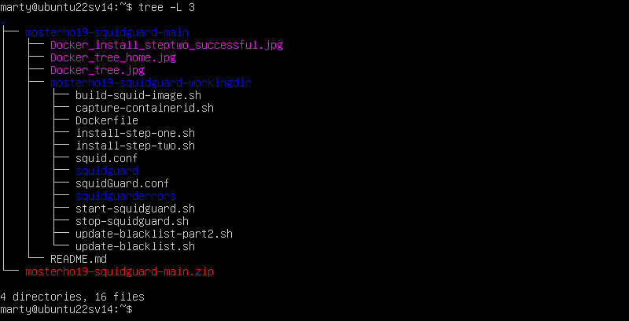
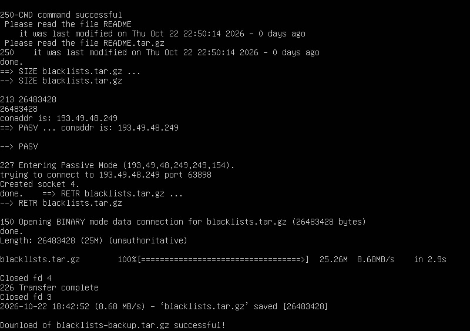
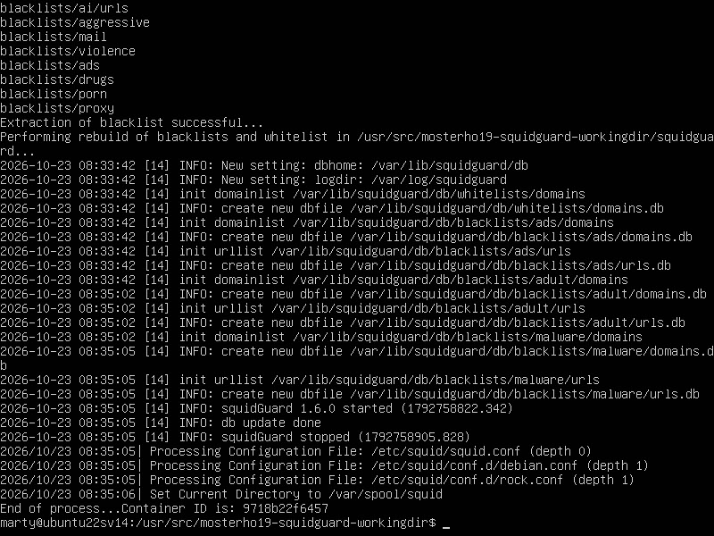
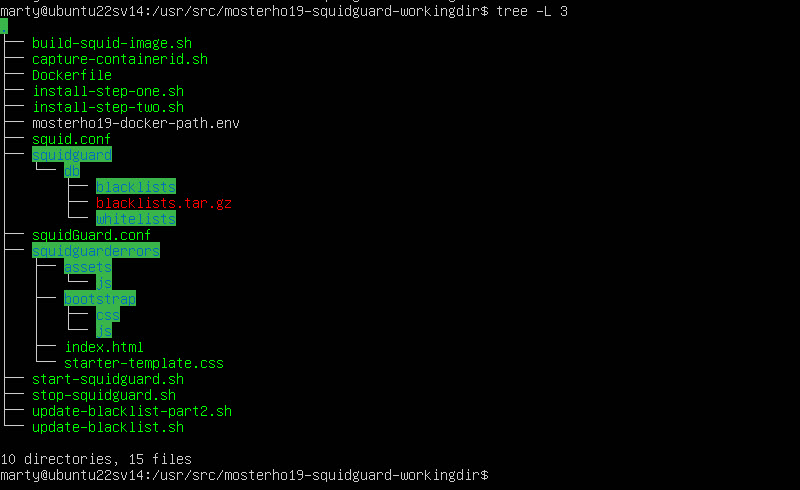
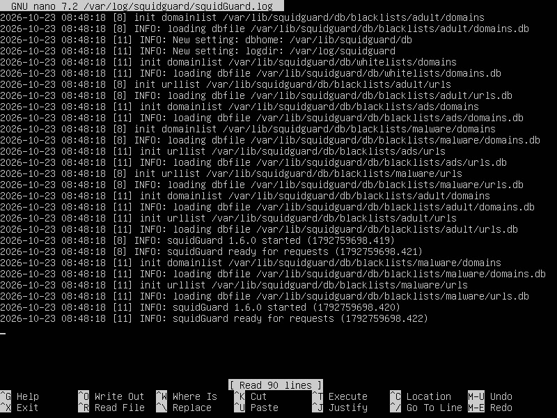
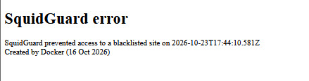

# Squid and Squidguard running in Docker on a Ubuntu server (version 22.04.5)
### I am very new to Docker, so this is very much a work in process. I have also learned a lot about bash scripting, so hopefully this will be relatively easy to install.
### If you've been following this repository, I think I'll finally have a stable version as of 26 October 2026. From now on I'll follow the convention regarding stable versus release, etc.

> "The first 90 percent of the code accounts for the first 90 percent of the development time. The remaining 10 percent of the code accounts for the other 90 percent of the development time."

### Note that my Docker profile is "mosterho19" and github is "mosterho". My Docker repository can be [found here (Docker)](https://hub.docker.com/repository/docker/mosterho19/squidguard/general). Source code in github can be [found here (github)](https://github.com/mosterho/mosterho19-squidguard/tree/main).

## Notes
<ol>
<li>When referencing /home/(your_working_folder) in this document, the actual path can be whatever you wish. I chose "/home/mosterho19-squidguard-workingdir" for my system. During testing I have installed the objects in different folder paths (e.g., "/usr/src/mosterho19-squidguard-workingdir") and the instructions work.</li>
<li>In order to download the application, log on to a PC. Go to the github repository, click the green Code button, and select Download ZIP. Copy the file to the new server's folder of your choice (on a Windows PC you can use Filezilla client or the scp command).</li>
<ul>
<li>NOTE: git is installed on the server, but I'm not familiar enough with git's command lines to pull the repository onto the server. 
</ul>
</ol>

[github repository here](https://hub.docker.com/repository/docker/mosterho19/squidguard/general)

## Quick Start Install Guide
<ol>
<li>Install Ubuntu server, latest updates, and Docker options.
<li>Download and unzip mosterho19-squidguard-main.zip in folder /usr/src.
<li>Make any neccessary changes to files (e.g., squid.conf, squidguard.conf, etc.)
<li>In /usr/src/mosterho19-squidguard-workingdir folder, run "sudo bash ./install-step-one.sh"
<li>In /usr/src/mosterho19-squidguard-workingdir folder, run "sudo bash ./install-step-two.sh"
<ul><li>See the "ISSUES" section if the wget download from the site doesn't work</li></ul>
<li>Confirm squid, squidguard and httpd are running in the Docker session.
</ol>

## Install Ubuntu server.
<ol>
<li>Install Ubuntu server 22.04.5. Mine is on VMware Workstation, 4Gb of memory with 1 processor/4 core and 50Gb of disk. 
	<ul>
	<li>Accept defaults during install, except check the box to install ssh-server (you may need this later).</li>
	</ul>
</li>
<li>sudo apt update</li>
<li>sudo apt full-upgrade</li>
<li>sudo apt install docker docker.io docker-buildx unzip net-tools tree</li>
<li>If you're using VMware, consider installing vmware-manager.
	<ul>
	<li>sudo apt install vmware-manager</li>
	</ul>
<li>sudo dpkg-reconfigure tzdata (select the time zone applicable for you)</li>
<li>timedatectl (confirms the tzdata change)</li>
<li>ifconfig
	<ul>
	<li>make a note of the assigned IPv4 address of the network adapter</li>
</li>
</ol>

## Download folders and files
<ol>
<li>If you haven't done so already, download the repository from github, but don't extract or run anything just yet.

[github](https://github.com/mosterho/mosterho19-squidguard/tree/main)

<ul>
	<li>mosterho19-squidguard-main.zip -- this contains basic folder structures and bash files for running squidguard. This does not include the squidguard db files that contain the blacklists.tar.gz; this will be built later.
</ul>
<li>Copy the mosterho19-squidguard-main.zip file to the new server's folder of your choice (I use Filezilla client to push the file to the new server and into my home logon folder).
<li>Log on to the server
<li>Optional: On the server, copy or move file "mosterho19-squidguard-main.zip" to your preferred directory such as /user/(your_user_name) or /usr/src/
<li>Run the following: "sudo unzip mosterho19-squidguard-main.zip". This will create the mosterho19-squidguard-main folder with user "root" as the owner.
<li>The top-most folder in the heirarchy should be mosterho19-squidguard-main (the name of the github project), with mosterho19-squidguard-workingdir (the folder containing the objects to run squidguard) beneath it.
<li>Run "cd mosterho19-squidguard-main" and run "tree -L 3" from your working folder, the results should look like this (as I tweak documentation, the number of .jpg files may change):</li>

<li>If you unzipped the folders in your /home/user directory and you now wish to move just the required objects to /usr/src, you can do this now by:
<ul>
<li>sudo mv mosterho19-squidguard-main/mosterho-squidguard-workingdir/ /usr/src/
<li>cd /usr/src/mosterho19-squidguard-workingdir
</ul>
<li>If you haven't done so already, change the present working directory to mosterho19-squidguard-main (Run the following: cd mosterho19-squidguard-main)
</ol>

## Pull Docker images
<ol>
<li>Ensure you are in (your_working_folder)/mosterho19-squidguard-workingdir (or usr/src/mosterho19-squidguard-workingdir) -- you should have sufficient rights to save and run bash files.
<li>run "sudo bash ./install-step-one.sh"
<li>This will pull Docker images mosterho19/squidguard and httpd and create the corresponding containers. It will also create a file "mosterho19-docker-path.env".
<li>The script will show the results of creating the containers (sudo docker ps -a) 
</ol>

## Setup Docker folders and files
<ol>
<li>Run "install-step-two.sh"
<li>There will be a series of commands that will display results very fast. 
<li>There is a possibility that the blacklists.tar.gz download may fail. Buried in the lines of results, you may see "failed:connection refused" and "error code 4: wget failed to download the file". The squidguard process is running, but there is no blacklist to stop undesired traffic. you can wait a few minutes and run "install-step-two.sh" again, or see the ISSUES section below to grab the blacklists.tar.gz using another method.
<li>If the blacklists.tar.gz download is running/successful, you should be able to catch something like the screen capture below.</li>
<li>Also, when the script reaches the point of building the blacklists, it may appear that the system froze, but it is running OK.

---

<li>Confirm the following folders and files are in (your_working_folder) and make changes to files as needed (e.g,, squid.conf, squidguard.conf, etc.)
	<ul>
	<li>directory "squidguard" -- The blacklist and whitelist files will be setup in this directory. 
	<li>directory squidguarderrors. This is used by the httpd image. This contains a couple folders and an index.html file. The html file is used for issuing a warning message when attempting to display a blacklisted site. 
	<li>file squid.conf -- there are over 9000 lines in the original squid.conf file; this file contains about 100 lines. All of the uncommented lines with some of the important comments were included. This contains the minimum required to get squidguard up and running. You will need to tweak this file to get your container up and running (e.g., I assume you don't need the dns_nameservers tag at the very end; I just happen to use an Intranet). 
	<li>file squidGuard.conf -- Currently setup to include all localnet IP addresses, a blacklist, and whitelist. The blacklists currently include ads, adult, and malware. You will need to change the IP address of the redirect statement to match your IP (not sure if localhost will work in place of an IP address). 
	<li>The extra .sh files can be modified to create your own version of this application as needed.
	</ul>
</li>
<li>Once you setup the above folders and files, the tree structure should look like this (if you don't see the picture in Docker, try Github):</li>
</ol>

## Confirm Squidguard is running
<ol>
<li>Confirm that the containers are still running by running "sudo docker ps -a"
<li>Make a note of the "mosterho19/squidguard" containerid that is running.
<li>Run "sudo docker exec -it (first 2-3 letters of the containerid without parenthesis) bash". Confirm you are in the running container by checking your login.
	<ul>
	<li>The login and folder should look like "root@d36c...:/#".
	</li>
	</ul>
<li>Run "nano /var/log/squidguard/squidGuard.log"
<li>Confirm that the last line reads "squidguard ready for requests".
<li>If you see several "db_open: permission denied", the issue is likely back on the host. The tar extract will likely create the folders with root as the owner.
<li>Exit the Docker terminal session. Change your current directory to /home/()/squidguard (or /usr/src/mosterho19-squidguard-workingdir). Squidguard pulls files from the host. Please double-check folder permissions in your working directory and "squidguard/db".

<li>*** If the download fails, please perform the instructions in the "ISSUES" section below and return to this point.
<li>Run the following steps (again) to confirm you have the domains.db created and the system is running.
<li>Run the "sudo bash ./start-squidguard.sh" file again. This should show that the docker containers are stopping and then restart.
<li>Obtain the new "mosterho19/squidguard" container ID that is running.
<li>Run "sudo docker exec -it (containerid) bash". Confirm you are in the running container by checking your login.
</ol>

## Open a browser and try it ;-) 
<ol>
<li>Change your system's proxy to point to the IP address of the server that hosts this application.
<li>Open a browser. Go to a site that you wish to block. Hopfully you will see the following:

</ol>
## Issues
<ol>
<li>While doing test installations, I've made a handful of mistakes, such as forget to copy the "mosterho19-squidguard-workingdir" directory to /usr/src. It seems to work if you work with that directory as needed when running scripts, running "chown", etc. Or you can find all objects unzipped from the "mosterho19-squidguard-main.zip", delete them and start the install over.
<li>IMPORTANT: The scripts to download the blacklists (update-blacklist.sh than runs within install-step-two.sh) from this [Blacklist FTP Download site](ftp://ftp.ut-capitole.fr/pub/reseau/cache/squidguard_contrib/blacklists.tar.gz) doesn't always cooperate. 
<ul>
<li>Open a browser and use the following link to download the blacklists.tar.gz file. 

([Blacklist download website here](https://dsi.ut-capitole.fr/blacklists/download/))
<li>If you receive an error message, the site may be down for maintenance.

([Homepage for Blacklist website here](https://dsi.ut-capitole.fr/))

<li>Once the blacklists.tar.gz file is downloaded using a web browser, copy it to "mosterho19-squidguard-workingdir/squidguard/db".
<li>Return to the terminal session and ensure you are in directory "mosterho19-squidguard-workingdir". 
<li>Run "sudo bash ./update-blacklist-part2.sh"</li>
</ul>
</ol>

# Next Steps for this Project
<ol>
<li>Learn how to pull github files to the server rather than download on a PC and then copy the file.</li>
<li>Learn how to create a .deb file to install on Ubuntu.
<li>Install on Microsoft Azure.
<li>Maybe install an FTP server on MS Azure and keep a copy of the https://dsi.ut-capitole.fr/blacklists/download on it for developers as a last ditch copy.
</li>